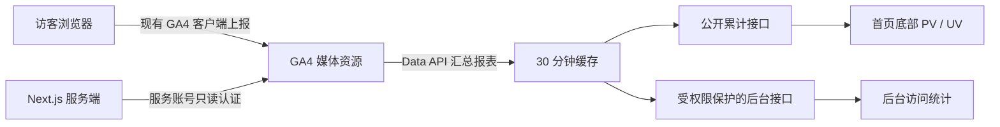

# GA4 全站访客与访问统计

## 数据来源与口径

正式站点是 `https://www.nnnnzs.cn`。客户端沿用 `SiteThirdParties.tsx` 中已有的 GA4/GTM 配置上报；服务端通过 Google Analytics Data API 读取汇总报表，首页底部和 `/c/analytics` 使用同一数据源。

| 展示项 | GA4 指标 | 含义 |
| --- | --- | --- |
| 累计浏览 PV | `screenPageViews` | web 平台的页面浏览次数，包含重复浏览 |
| 累计访客 UV | `totalUsers` | 查询区间内 GA4 去重的总用户数，不等同于实名人数 |
| 访问会话 | `sessions` | GA4 定义的访问会话，与聊天会话无关 |
| 页面排行 | `pagePath` + PV、UV | 按页面路径排序的前 50 项 |
| 来源排行 | `sessionSource`、`sessionMedium` + sessions | 按来源/媒介的会话数排序的前 50 项 |

区间 UV 使用不带维度的独立查询，不能将每日 UV 或各页面 UV 相加。GA4 用户识别、Cookie 设置、脚本拦截、网络和处理延迟都会影响结果。本站不另建访客档案、访问明细、每日汇总表，不新增访客 Cookie，不关联账号或聊天记录。

所有查询按 `hostName` 精确匹配 `GA4_REPORT_HOSTNAME`，默认 `www.nnnnzs.cn`，并过滤 web 平台。本地开发读取正式站点报表，不受本地 `NEXT_PUBLIC_SITE_URL` 影响。该过滤也意味着其他域名的历史访问不计入当前站点累计。

## 数据流



文章累计阅读量沿用 `TbPost.visitors` 和原有文章访问接口，与 GA4 报表不要求一致。点赞接口继续使用原有防刷记录，不再通过服务端 Measurement Protocol 重复转发互动，也不创建自定义 GA 会话 Cookie。

## Google 配置

### 标识与权限

- 数字 Property ID 是报表读取对象；当前媒体资源为 `514814347`（孤人独影）。
- `G-` 开头的 Measurement ID 用于客户端采集；`ga4.api_secret` 是 Measurement Protocol 上报凭据，两者都不能读取报表。
- 在 Google Cloud 项目中启用 **Google Analytics Data API**（`analyticsdata.googleapis.com`）。
- 服务账号不需要 Google Cloud 项目角色；在 GA4「管理 → 媒体资源访问权限管理」将其添加为「查看者」。可限制费用和收入指标，本功能不使用这些指标。
- 只读 OAuth scope 为 `https://www.googleapis.com/auth/analytics.readonly`。认证使用官方 `google-auth-library`。

若组织策略禁止创建服务账号密钥，需先由有权限的管理员处理组织策略或采用组织允许的认证方式；不能把上报密钥当作替代凭据。代码当前接受服务账号 JSON，不支持交互式用户 OAuth 登录。

### 服务端凭据

本地与 Docker 生产环境统一使用各自未提交的 `.env` 中的 `GA4_SERVICE_ACCOUNT_JSON`，值为完整的单行 JSON；Compose 通过 `env_file` 在容器运行时注入。限制 `.env` 权限为 `0600`，不要把 JSON、私钥或访问令牌提交到 Git、写入公开后台配置或打印日志。若采用文件挂载，可改用 `GOOGLE_APPLICATION_CREDENTIALS`，文件必须放在仓库外并只读挂载。

```dotenv
GA4_PROPERTY_ID=514814347
GA4_REPORT_HOSTNAME=www.nnnnzs.cn
GA4_SERVICE_ACCOUNT_JSON=
# 可选，明确指定累计区间起点
GA4_STATS_START_DATE=
```

`GA4_SERVICE_ACCOUNT_JSON` 优先于 `GOOGLE_APPLICATION_CREDENTIALS`。不要使用 `NEXT_PUBLIC_` 前缀；GitHub Actions 构建镜像不需要此变量或密钥，生产容器从 VPC 上的 `.env` 读取运行时值。

数字媒体资源 ID 和可选起始日期也可保存在启用的 `TbConfig` 记录 `ga4.property_id`、`ga4.stats_start_date`；对应环境变量优先。未指定起始日期时，请求从 `2015-08-14` 到 GA4 的 `today`，覆盖该媒体资源可查询的历史，前台标注「GA4 累计」。该日期是 Data API 接受的最早起点，不代表站点上线或实际开始采集日期。GA4 无法补回接入前或未采集的访问。

### 网络与部署

Data API 请求在服务器完成，访客只请求本站汇总接口。大陆部署环境需验证服务器可访问 Google OAuth 与 `analyticsdata.googleapis.com`；GA4 的报表请求和服务账号令牌请求都会优先使用 `GITHUB_PROXY_URL`，其次使用 `HTTPS_PROXY` / `HTTP_PROXY`。浏览器上报仍受访客网络和拦截设置影响。

生产环境使用 `[vpc] /www/wwwroot/react.nnnnzs.cn/.env` 中的 `GA4_SERVICE_ACCOUNT_JSON`，文件权限设为 `0600`，Compose 在容器启动时注入。服务账号 OAuth 和 Data API 请求均复用 `GITHUB_PROXY_URL`；本地和 VPC 分别维护各自配置，不跨主机复制路径或凭据文件。若改用 `GOOGLE_APPLICATION_CREDENTIALS` 文件方式，再将仓库外的凭据文件只读挂载到容器。

## 接口、缓存和展示

| 接口 | 权限 | 内容 |
| --- | --- | --- |
| `GET /api/analytics/public` | 公开 | 仅累计 UV、PV、区间起点、查询时间和数据来源 |
| `GET /api/analytics/overview` | `analytics:view` + `all` | 区间总量、逐日趋势、页面与来源排行 |

后台 `from`、`to` 格式为 YYYY-MM-DD，默认最近 7 天，最多 730 天，不接受未来日期。日期快捷选项按北京时间计算；报表展示 GA4 返回的媒体资源时区。

服务端缓存 30 分钟，公开接口另允许共享缓存 5 分钟。缓存键包含媒体资源、主机名、日期范围和凭据指纹，不包含私钥。GA4 本身还有处理延迟，因此显示不承诺实时。首页统计区进入视口后才请求，页面恢复或网络恢复时可刷新；不增加额外采集事件。

公开计数使用十进制字符串传输，避免大整数精度损失。未配置或读取失败时返回不可用，首页显示 `—`，不会把认证失败显示成 0。后台对配置缺失给出提示，对阈值、抽样和高基数 `(other)` 数据给出报表警告。总量合法空结果可以显示 0。

## 初始化与验证

本项目 Mac 开发结构同步使用 Prisma db push，不提供手写建表 SQL。本功能只使用既有配置和 RBAC 模型，没有独立统计 schema 或维护任务。

```bash
pnpm analytics:install             # 查看初始化范围
pnpm analytics:install --apply     # 补齐配置、权限和两个只读 API
pnpm analytics:verify              # 实际读取 GA4 累计报表，不使用缓存
pnpm test:analytics
pnpm typecheck
```

初始化不会全量重置 RBAC；只为 admin 补齐 `analytics:view` 全站范围，停用已废弃的采集接口注册。服务由用户手动启动。真实验收需验证 GA4 Viewer 权限、API 启用、凭据与服务器网络，并比较同域名、同日期和同指标口径的数据。

## 参考

- [GA4 Data API 指标与维度](https://developers.google.com/analytics/devguides/reporting/data/v1/api-schema)
- [runReport](https://developers.google.com/analytics/devguides/reporting/data/v1/rest/v1beta/properties/runReport)
- [Data API 快速开始](https://developers.google.com/analytics/devguides/reporting/data/v1/quickstart)
- [GA4 数据处理时效](https://support.google.com/analytics/answer/11198161)
